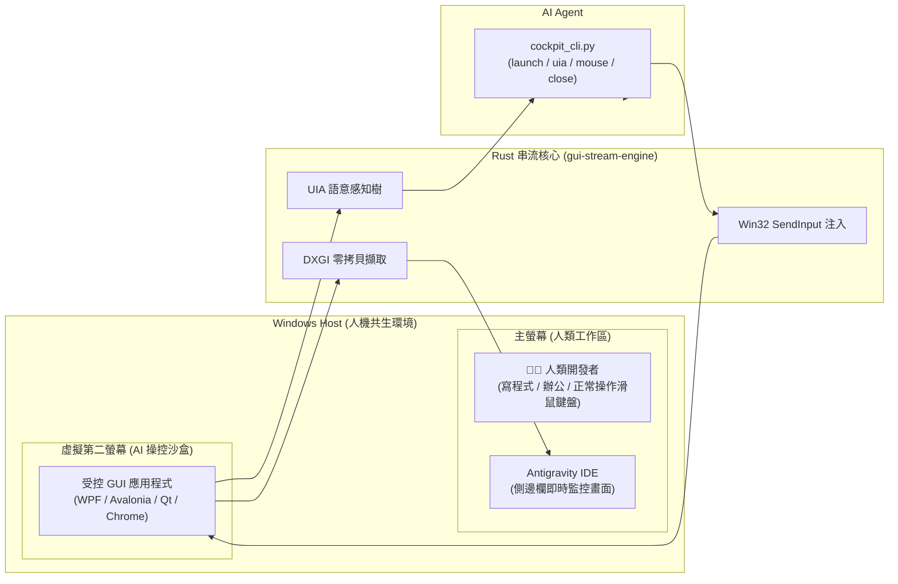

# Antigravity Desktop Cockpit (ADC)
### 🚀 人機零干擾 Windows 虛擬顯示器桌面駕駛艙 (Zero-Interference Computer-Use Sandbox)

<p align="center">
  
</p>

<p align="center">
  
  
  
  
  
  
  
</p>

> **專為 AI Agent Computer-Use 與桌面 GUI 自動化設計的高效能沙盒**  
> 透過 Windows 虛擬第二螢幕（Virtual Display Driver）結合純 Rust 高效能串流引擎（DXGI + SIMD JPEG），讓 AI Agent 在完全不干擾人類、實體滑鼠 0 位移、0 彈窗搶焦點的前提下，實現對桌面應用程式（WPF, Avalonia, Qt, WinForms, Chrome, Office 等）的完整生命週期操控與精準驗收。

---

## ⚡ 痛點對比 (Why Desktop Cockpit?)

| 特性 | 傳統 AI 桌面自動化 (PyAutoGUI / 傳統腳本) | 專用虛擬機 (VM / Docker) | **Antigravity Desktop Cockpit (ADC)** |
| :--- | :--- | :--- | :--- |
| **實體滑鼠干擾** | ❌ **強烈干擾** (游標亂跳、打斷人類工作) | ✔ 隔離 (但開銷極大) | 🌟 **完全 0 干擾** (虛擬第二螢幕沙盒) |
| **彈窗焦點搶奪** | ❌ 視窗閃爍、打斷當前打字輸入 | ✔ 隔離 | 🌟 **完全 0 彈窗** (STARTUPINFO 離屏生成) |
| **資源消耗** | 輕量但脆弱 | ❌ 佔用數 GB 記憶體、開機緩慢 | 🌟 **極度輕量** (~15MB RAM, <2% CPU) |
| **感知與定位精度** | ❌ 純視覺截圖易飄移、易受解析度影響 | 視工具而定 | 🌟 **雙重閉環** (UIA 語意樹精準點擊 + 60FPS DXGI 截圖) |
| **端到端延遲** | 100ms ~ 500ms | 50ms ~ 150ms | 🌟 **< 15ms** (純 Rust 原生編譯) |
| **隨開即用** | 需手動佈局環境 | 需虛擬化支援 | 🌟 **一鍵 CLI / RPC 隨開即用** |

---

## 🌟 核心特色

1. **實體滑鼠 0 位移、0 搶奪焦點 (Zero-Mouse-Stealing)**：
   - 所有目標受控程式均在獨立的虛擬第二螢幕執行。
   - 人類在主螢幕寫程式、打字、瀏覽網頁，AI 在虛擬第二螢幕自動啟動、點擊、測試 GUI，兩者完全互不干擾。
2. **純 Rust 串流引擎 (`gui-stream-engine`)**：
   - 採用純 Rust 原生編譯（Windows GDI / Direct DIB / DXGI 零拷貝提取 + SIMD JPEG 編碼），二進位檔體積僅 ~980 KB。
   - 記憶體佔用極低（~15 MB），CPU 佔用 <2%，端到端延遲低於 15ms。
3. **語意 (UIA) 與視覺 (DXGI) 雙重閉環**：
   - 內建 Windows UI Automation 語意樹搜尋，自動解析按鈕、文字框並轉換為歸一化 `(u, v)` 點擊座標。
   - 搭配 60 FPS DXGI 硬體即時截圖與 Visual Memory 差異對話框偵測，絕不點歪。
4. **完整應用生命週期管理 (Full Lifecycle)**：
   - `launch`：零彈窗離屏啟動應用程式。
   - `close`：兩階段退出保護（優先優雅 `WM_CLOSE`，可選 `--force` 強制終結）。
5. **人類第一優先接管 (Human-First Override)**：
   - 整合於 Antigravity 側邊面板（Auxiliary Pane），支援即時畫面串流；人類隨時可在面板畫布上即時操作，AI 即刻禮讓。

---

## 🏗️ 系統架構



---

## 🚀 快速上手 (Quick Start)

### 1. 啟動 GUI 應用程式 (0 彈窗干擾)
```powershell
python.exe -X utf8 cockpit_cli.py launch "notepad.exe"
```

### 2. 探測按鈕語意與座標 (UIA)
```powershell
# 自動搜尋包含「確定」或「OK」的按鈕，回傳歸一化座標 (u, v)
python.exe -X utf8 cockpit_cli.py uia --hwnd 0x1A02E -f "確定"
```

### 3. 滑鼠與鍵盤注入
```powershell
# 點擊指定座標
python.exe -X utf8 cockpit_cli.py mouse click 0.5 0.5 --hwnd 0x1A02E

# 輸入多語系文字 (WM_CHAR 注入，免切換輸入法)
python.exe -X utf8 cockpit_cli.py type "Hello AI World!" --hwnd 0x1A02E

# 發送快捷鍵
python.exe -X utf8 cockpit_cli.py hotkey "ctrl+s" --hwnd 0x1A02E
```

### 4. 即時截圖驗收
```powershell
python.exe -X utf8 cockpit_cli.py capture -o "screenshot.jpg" --hwnd 0x1A02E
```

### 5. 優雅關閉視窗
```powershell
python.exe -X utf8 cockpit_cli.py close 0x1A02E
```

---

## 📚 延伸文件

- [API 參考手冊 (API Reference)](./API_REFERENCE.md)：完整的 WebSocket JSON 協議、全指令 Schema 與 Python/Node.js 調用範例。
- [AI Skill 規範 (SKILL.md)](./skills/desktop-cockpit/SKILL.md)：AI Agent 操作指引與最佳實踐。

---

## 🤝 參與貢獻 (Contributing)

歡迎提交 Issue 與 Pull Request！
- 核心引擎：`engine/` (Rust, Powered by **RustDesk** 原生高效架構與 DXGI 擷取技術)
- 前端面板：`sidecars/panel/` (HTML5 / TypeScript)
- AI 介面：`skills/desktop-cockpit/` (Python CLI)

---

## 🙏 致敬與致謝 (Acknowledgments)

本專案在底層硬體截圖、Windows 虛擬顯示器 (Virtual Display) 拓撲以及極致低延遲串流技術上，深度借鏡與汲取了開源遠端桌面旗艦 **[RustDesk](https://github.com/rustdesk/rustdesk)** 的優秀設計與實作。感謝 RustDesk 開源社群對 Rust 桌面底層生態的卓越貢獻！

---

## 📄 開源授權 (License)

本專案採用 [MIT License](LICENSE) 開源授權。
