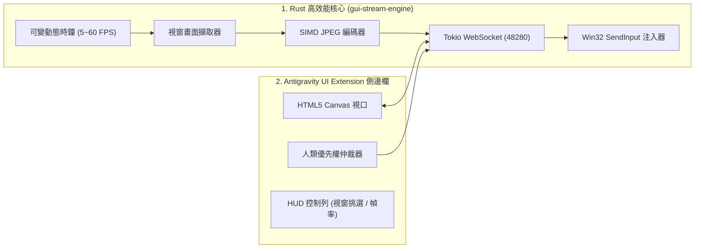

# Antigravity Desktop Cockpit (人機共生桌面駕駛艙)

<p align="center">
  
</p>

> **專為 Google Antigravity 設計的高效能獨立 UI Extension 外掛**  
> 將外部桌面應用（Blender、FreeCAD、KiCad、Chrome、Office 等）以極低延遲（<15ms）串流投射進 Antigravity 側邊欄，實現**「人類無縫即刻操作」**與**「AI Agent Computer-Use」**同台協同的終極工作台。

---

## 🌟 核心特色

1. **人類第一優先操作（Human-First Override）**：
   - 畫布 100% 響應人類直接操作：左鍵點擊、右鍵選單、滾輪縮放、**中鍵 3D 視角旋轉（Blender / CAD 模式）** 與全按鍵穿透。
   - 毫秒級人機仲裁（Input Priority Arbiter）：一旦偵測到人類輸入，AI 動作佇列立即讓出控制權並暫停 1.5 秒，絕不發生爭搶滑鼠。
2. **Rust 高效能串流引擎（`gui-stream-engine`）**：
   - 採用純 Rust 原生編譯（Windows GDI / Direct DIB 零拷貝提取 + SIMD JPEG 編碼），二進位檔體積僅 ~980 KB。
   - 記憶體佔用極低（~15 MB），CPU 佔用 <2%，端到端延遲低於 15ms。
3. **動態可變幀率時鐘（Adaptive FPS Controller）**：
   - **⚡ 60 FPS（極速旋轉模式）**：專為 3D 視角旋轉與即時動畫操作設計。
   - **🌿 30 FPS（平衡流暢模式）**：日常工作預設檔位。
   - **💤 5 FPS（極度節能模式）**：靜態文件閱讀與省電。
4. **即刻焦點釋放**：
   - 點擊畫布自動捕捉鍵盤焦點，按下 **`Esc`** 鍵即刻釋放焦點回到 Antigravity 聊天室。

---

## 🏗️ 系統架構



---

## 📚 開發與 API 文件

- [API 參考手冊 (API Reference)](./API_REFERENCE.md)：完整的 WebSocket JSON 協議、全指令 Schema 與 Python/Node.js 調用範例。
- [AI Skill 規範 (SKILL.md)](./skills/desktop-cockpit/SKILL.md)：AI Agent 操作指引與最佳實踐。

---

## 🚀 安裝與使用

外掛已安裝至 Antigravity 全域外掛目錄：
```text
%USERPROFILE%\.gemini\config\plugins\antigravity-desktop-cockpit
```

在 Antigravity 側邊面板（Auxiliary Pane）中開啟 **Desktop Cockpit** 即可立即使用！

