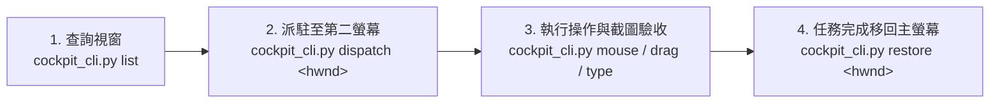

# Desktop Cockpit (ADC) AI Agent 操作指南

本 Skill 專供 AI Agent 在 Windows 環境下操控桌面應用程式，實現**人機零干擾 (Zero-Interference)** 自動化：
- **實體滑鼠 0 位移、0 搶奪焦點**：所有受控目標視窗均派駐於獨立的虛擬第二螢幕（預設座標：$X = 3200, Y = -1000$）。
- **底層引擎端點**：由後台高效能 Rust 引擎 (`gui-stream-engine.exe`) 監聽 `ws://127.0.0.1:48280`。
- **唯一推薦操作途徑**：AI Agent **一律使用標準 CLI 腳本** 執行所有控制，無需自行撰寫 WebSocket 通訊腳本。

---

## 0. 核心工具腳本位置

主控制腳本為 `cockpit_cli.py`：
- **工作區路徑**：`D:\AntiGravity\Agent-Study\antigravity-desktop-cockpit\skills\desktop-cockpit\scripts\cockpit_cli.py`
- **外掛安裝路徑**：`D:\Users\arco0\.gemini\config\plugins\antigravity-desktop-cockpit\skills\desktop-cockpit\scripts\cockpit_cli.py`

> **執行規範**：在 Windows PowerShell 環境下，一律使用 `python.exe -X utf8` 執行腳本以防編碼異常。

---

## 1. 鍵盤輸入 (Keyboard Operations)

AI Agent 在操控應用程式時，依輸入類型選擇以下三種鍵盤方法：

### A. 多語系純文字注入 (`type`)
用於在文字框、編輯器、表單或輸入框中鍵入任意字串（支援中文、英文、特殊符號、Emoji）。
```powershell
python.exe -X utf8 "D:\Users\arco0\.gemini\config\plugins\antigravity-desktop-cockpit\skills\desktop-cockpit\scripts\cockpit_cli.py" type "欲輸入的文字" --hwnd 0x30790
```
- **底層機制**：使用 Win32 `WM_CHAR` 逐字安全注入，不依賴本機輸入法（IME），不觸發 CapsLock 錯亂。
- **參數說明**：
  - `text`：欲鍵入的字串。
  - `--hwnd`：可選，目標視窗的 HWND（支援十進位或 `0xHEX`）。

### B. 直通發送組合鍵與功能鍵 (`hotkey`)
用於觸發快捷鍵、功能鍵與選單指令（如全選、複製、貼上、Enter、Esc、方向鍵）。支援以 `--hwnd` 直接鎖定目標視窗發送：
```powershell
# 複製與貼上 (支援指定目標視窗 --hwnd)
python.exe -X utf8 "D:\Users\arco0\.gemini\config\plugins\antigravity-desktop-cockpit\skills\desktop-cockpit\scripts\cockpit_cli.py" hotkey "ctrl+c" --hwnd 0x30790
python.exe -X utf8 "D:\Users\arco0\.gemini\config\plugins\antigravity-desktop-cockpit\skills\desktop-cockpit\scripts\cockpit_cli.py" hotkey "ctrl+v" --hwnd 0x30790

# 送出表單或確認 (Enter)
python.exe -X utf8 "D:\Users\arco0\.gemini\config\plugins\antigravity-desktop-cockpit\skills\desktop-cockpit\scripts\cockpit_cli.py" hotkey "enter" --hwnd 0x30790

# 放棄或取消 (Esc)
python.exe -X utf8 "D:\Users\arco0\.gemini\config\plugins\antigravity-desktop-cockpit\skills\desktop-cockpit\scripts\cockpit_cli.py" hotkey "esc"

# 關閉視窗 (Alt+F4)
python.exe -X utf8 "D:\Users\arco0\.gemini\config\plugins\antigravity-desktop-cockpit\skills\desktop-cockpit\scripts\cockpit_cli.py" hotkey "alt+f4" --hwnd 0x30790
```
- **支援鍵位**：
  - 修飾鍵：`ctrl`, `alt`, `shift`。
  - 功能鍵：`enter`, `backspace`, `tab`, `esc`, `space`, `left`, `right`, `up`, `down`, `delete`, `home`, `end`, `pageup`, `pagedown`。
  - 字母鍵：`a` ~ `z`。

### C. 瀏覽器安全網址導航 (`open-url`)
**嚴禁在未聚焦時盲發 Ctrl+T/Ctrl+L！** 瀏覽器網址跳轉一律使用 `open-url`：
```powershell
python.exe -X utf8 "D:\Users\arco0\.gemini\config\plugins\antigravity-desktop-cockpit\skills\desktop-cockpit\scripts\cockpit_cli.py" open-url "https://github.com" --hwnd 0x30790
```
- **自動化管線**：自動鎖定目標視窗 $\to$ 聚焦網址列（Ctrl+L） $\to$ 貼入網址（Ctrl+V） $\to$ 送出 Enter 導航 $\to$ 自動備份與還原使用者當前的本機剪貼簿內容，且自動歸還主螢幕焦點，達成真正的零干擾。

---

## 2. 滑鼠操控 (Mouse Operations)

### 座標系統說明：歸一化座標 `(u, v)`
所有滑鼠命令均採用 **歸一化浮點數座標 $(u, v)$**，範圍介於 `0.0` 至 `1.0`：
- `(0.0, 0.0)` 代表視窗或螢幕的 **左上角**。
- `(1.0, 1.0)` 代表視窗或螢幕的 **右下角**。
- `(0.5, 0.5)` 代表 **正中心**。
> [!NOTE]
> **絕對座標轉換基準**：若傳入大於 1.0 的絕對螢幕像素座標（例如 `4160 300`），CLI 會自動以**虛擬螢幕原點及解析度**（預設 $X \ge 3200, Y \ge -1000$）換算為歸一化座標。請勿傳入主實體螢幕座標。

### A. 滑鼠點擊 (`mouse click`)
點擊目標位置（支援左鍵、右鍵、中鍵）：
```powershell
# 點擊畫面中心 (左鍵)
python.exe -X utf8 "D:\Users\arco0\.gemini\config\plugins\antigravity-desktop-cockpit\skills\desktop-cockpit\scripts\cockpit_cli.py" mouse click 0.5 0.5

# 點擊右鍵開啟右鍵選單
python.exe -X utf8 "D:\Users\arco0\.gemini\config\plugins\antigravity-desktop-cockpit\skills\desktop-cockpit\scripts\cockpit_cli.py" mouse click 0.35 0.42 -b right

# 點擊指定視窗
python.exe -X utf8 "D:\Users\arco0\.gemini\config\plugins\antigravity-desktop-cockpit\skills\desktop-cockpit\scripts\cockpit_cli.py" mouse click 0.25 0.18 --hwnd 0x30790
```

### B. 底層原生滑鼠手勢 (`down` / `move` / `up`)
當需要自訂長按、停留或特殊手勢時，可直接調用底層動作：
```powershell
# 1. 在 (0.3, 0.4) 按下滑鼠按鈕 (down)
python.exe -X utf8 "D:\Users\arco0\.gemini\config\plugins\antigravity-desktop-cockpit\skills\desktop-cockpit\scripts\cockpit_cli.py" mouse down 0.3 0.4 -b left --hwnd 0x30790

# 2. 移動游標至 (0.5, 0.6) (move)
python.exe -X utf8 "D:\Users\arco0\.gemini\config\plugins\antigravity-desktop-cockpit\skills\desktop-cockpit\scripts\cockpit_cli.py" mouse move 0.5 0.6 --hwnd 0x30790

# 3. 釋放滑鼠按鈕 (up)
python.exe -X utf8 "D:\Users\arco0\.gemini\config\plugins\antigravity-desktop-cockpit\skills\desktop-cockpit\scripts\cockpit_cli.py" mouse up 0.5 0.6 -b left --hwnd 0x30790
```

### C. 滑鼠滾輪 (`wheel`)
在目標位置滾動滑鼠滾輪，用於瀏覽長頁面、放大縮小畫布或調整數值：
```powershell
# 在畫面中心向下滾動一格 (-120)
python.exe -X utf8 "D:\Users\arco0\.gemini\config\plugins\antigravity-desktop-cockpit\skills\desktop-cockpit\scripts\cockpit_cli.py" wheel 0.5 0.5 -d -120

# 鎖定特定視窗快速向下滾動三格 (-360)
python.exe -X utf8 "D:\Users\arco0\.gemini\config\plugins\antigravity-desktop-cockpit\skills\desktop-cockpit\scripts\cockpit_cli.py" wheel 0.5 0.5 -d -360 --hwnd 0x30790

# 向上滾動兩格 (+240)
python.exe -X utf8 "D:\Users\arco0\.gemini\config\plugins\antigravity-desktop-cockpit\skills\desktop-cockpit\scripts\cockpit_cli.py" wheel 0.5 0.5 -d 240
```
- **參數說明**：
  - `u` / `v`：滾輪生效的位置（預設 `0.5 0.5`）。
  - `-d / --delta`：滾動量。Win32 標準一格為 `120`。**正數代表向上滾動（向前推 / 放大），負數代表向下滾動（向後拉 / 縮小）**。
  - `--hwnd`：可選，鎖定特定目標視窗。

### D. 滑鼠拖曳 (`drag`)
執行平滑連續的拖曳操作（如框選、拖拉滑桿、選取文字、3D 視角旋轉）：
```powershell
# 1. 框選或拖拉物件 (左鍵，由 (0.2, 0.3) 拖至 (0.6, 0.7))
python.exe -X utf8 "D:\Users\arco0\.gemini\config\plugins\antigravity-desktop-cockpit\skills\desktop-cockpit\scripts\cockpit_cli.py" drag 0.2 0.3 0.6 0.7 --hwnd 0x30790

# 2. Blender 中鍵 3D 視角旋轉 (中鍵 middle，平滑 10 步插值，耗時 0.3 秒)
python.exe -X utf8 "D:\Users\arco0\.gemini\config\plugins\antigravity-desktop-cockpit\skills\desktop-cockpit\scripts\cockpit_cli.py" drag 0.5 0.5 0.7 0.3 -b middle --steps 10 --duration 0.3 --hwnd 0x30790
```
- **底層管線**：
  1. 游標平滑移動至起點 `(start_u, start_v)`。
  2. 發送 `down` 按下滑鼠按鍵（預設為左鍵 `left`）。
  3. 依據 `--steps` 在起點與終點路徑上均勻線性插值，連續發送多幀 `move` 事件，確保相容依賴硬體按鍵狀態偵測的各類應用（如 Firefox / Chrome 文字框選、Blender 視角旋轉）。
  4. 到達終點 `(end_u, end_v)` 後發送 `up` 釋放按鈕。
- **參數說明**：
  - `start_u`, `start_v`：拖曳起點歸一化座標。
  - `end_u`, `end_v`：拖曳終點歸一化座標。
  - `-b / --button`：`left`（預設）、`middle`（3D 旋轉常用）、`right`。
  - `--steps`：中間插值步數（預設 8 步）。
  - `--duration`：總耗時秒數（預設 0.25 秒）。
  - `--hwnd`：可選，鎖定特定目標視窗。

---

## 3. 視窗調度與管理 (Window Lifecycle)



### 常用命令清單
1. **查詢活動視窗**（支援標題過濾）：
   ```powershell
   python.exe -X utf8 "D:\Users\arco0\.gemini\config\plugins\antigravity-desktop-cockpit\skills\desktop-cockpit\scripts\cockpit_cli.py" list -f "Firefox"
   ```
2. **派駐至虛擬螢幕**（具備自動掛載虛擬顯示器、最大化並強制重繪機制）：
   ```powershell
   python.exe -X utf8 "D:\Users\arco0\.gemini\config\plugins\antigravity-desktop-cockpit\skills\desktop-cockpit\scripts\cockpit_cli.py" dispatch 0x704C4
   ```
3. **鎖定當前串流視窗**：
   ```powershell
   python.exe -X utf8 "D:\Users\arco0\.gemini\config\plugins\antigravity-desktop-cockpit\skills\desktop-cockpit\scripts\cockpit_cli.py" set 0x704C4
   ```
4. **截取目標畫面為圖片**（60 FPS DXGI 硬體即時截圖）：
   ```powershell
   python.exe -X utf8 "D:\Users\arco0\.gemini\config\plugins\antigravity-desktop-cockpit\skills\desktop-cockpit\scripts\cockpit_cli.py" capture -o "D:/screen.jpg" --hwnd 0x704C4
   ```
5. **任務完成移回主螢幕**：
   ```powershell
   python.exe -X utf8 "D:\Users\arco0\.gemini\config\plugins\antigravity-desktop-cockpit\skills\desktop-cockpit\scripts\cockpit_cli.py" restore 0x704C4
   ```

---

## 4. 虛擬螢幕硬體控制 (`display`)

無需依賴批次檔、零 UAC 彈窗，透過 Win32 DeviceIoControl 直通控制虛擬顯示器驅動：
- **查詢顯示器拓撲狀態**：
  ```powershell
  python.exe -X utf8 "D:\Users\arco0\.gemini\config\plugins\antigravity-desktop-cockpit\skills\desktop-cockpit\scripts\cockpit_cli.py" display status
  ```
- **掛載虛擬第二螢幕**：
  ```powershell
  python.exe -X utf8 "D:\Users\arco0\.gemini\config\plugins\antigravity-desktop-cockpit\skills\desktop-cockpit\scripts\cockpit_cli.py" display on
  ```
- **拔除虛擬第二螢幕（恢復單螢幕）**：
  ```powershell
  python.exe -X utf8 "D:\Users\arco0\.gemini\config\plugins\antigravity-desktop-cockpit\skills\desktop-cockpit\scripts\cockpit_cli.py" display off
  ```

---

## 5. 語意感知 (UIA) 與視覺記憶差異比對 (`diff`)

### A. 一般應用（Chrome、Firefox、Notepad、系統視窗）
支援標準 Windows UI Automation 語意樹搜尋：
```powershell
# 搜尋帶有「搜尋」關鍵字的按鈕或文字方塊，自動輸出歸一化 (u, v) 與一鍵點擊提示
python.exe -X utf8 "D:\Users\arco0\.gemini\config\plugins\antigravity-desktop-cockpit\skills\desktop-cockpit\scripts\cockpit_cli.py" uia --hwnd 0x704C4 -f "搜尋"

# 輸出節點類型分布統計概覽
python.exe -X utf8 "D:\Users\arco0\.gemini\config\plugins\antigravity-desktop-cockpit\skills\desktop-cockpit\scripts\cockpit_cli.py" uia --hwnd 0x704C4 -s
```

### B. 視覺記憶差異比對 (`diff`)
自動比對當前桌面與前一次快照之差異，專門用於秒級辨識新彈窗、報錯對話框或動態元素：
```powershell
python.exe -X utf8 "D:\Users\arco0\.gemini\config\plugins\antigravity-desktop-cockpit\skills\desktop-cockpit\scripts\cockpit_cli.py" diff
```

### C. 自繪畫布應用特例（Blender、Unity、Unreal Engine、遊戲）
> [!IMPORTANT]
> **Blender 視窗的 UIA Tree 只有 1 個標題列控制項，這是正常的！**
> * **原因**：Blender 使用獨有的 GHOST 視窗庫，所有按鈕、面板與 3D Viewport 皆由 GPU 著色器直接繪製在 OpenGL/Vulkan Framebuffer 上，未向 Windows 註冊 UIA 控制項。
> * **操作建議**：
>   1. **GUI 點擊與拖曳**：使用 `capture` 取得畫面，依視覺像素歸一化座標 `(u, v)` 呼叫 `mouse click`、`drag -b middle`（3D 視角旋轉）、`wheel`（縮放）。
>   2. **高階自動化**：Blender 內建世界級 Python API（`bpy`）。請優先使用 Antigravity 掛載的 `blender` MCP 工具 `execute_blender_code` 執行代碼，精確度 100%。

---

## 6. 常見問題與防雷守則 (Gotchas)

1. **80 像素物理重疊通道**：
   - 雙螢幕拓撲已在 $X = 3200, Y \in [0, 80]$ 預留 80 像素的滑鼠穿透缺口。
   - 使用者在面板操作完畢後，只要將實體滑鼠滑向第二螢幕左下角即可無縫滑回主螢幕右上角，無需強行搶奪焦點。
2. **人類操作優先原則 (1.5 秒禮讓)**：
   - 當人類使用者在側邊欄或實體滑鼠操作時，底層引擎會記錄活動時間。AI 指令會自動禮讓暫停 1.5 秒，避免人機搶奪。
3. **瀏覽器 UIA 啟用**：
   - **Firefox**：天生原生支援 UIA，即開即用。
   - **Chrome**：若需透過 UIA 穿透網頁結構，啟動時請帶上 `--force-renderer-accessibility` 參數。
