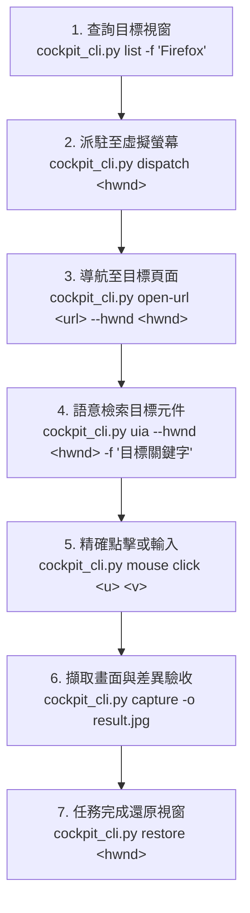

# Desktop Cockpit 2.0 (ADC 2.0) AI Agent 操作指引

本 Skill 提供 AI Agent 在 Windows 環境下操控桌面應用程式的**零干擾 (Zero-Interference)** 規範。
所有目標應用程式均運行於獨立的虛擬第二螢幕 (`\\.\DISPLAY14` 或 `\\.\DISPLAY82`，位於 $X \ge 3200$)，**使用者的主實體螢幕完全不受遮蔽，實體滑鼠 0 位移、0 奪取焦點**。

---

## 1. 核心操控方式：WebSocket API (`ws://127.0.0.1:48280`)

AI Agent 或外部程式可直接透過本機 WebSocket 連線至串流引擎發送 JSON 指令：

### 核心指令矩陣

| 指令 (`action`) | 說明 | 參數範例 |
| :--- | :--- | :--- |
| `get_windows` | 取得系統所有在線視窗與 HWND | `{ "action": "get_windows" }` |
| `get_monitors` | 取得 Windows 顯示器拓撲 | `{ "action": "get_monitors" }` |
| `plug_in_virtual_display` | 程式化掛載虛擬第二螢幕 (0 批次檔、0 UAC) | `{ "action": "plug_in_virtual_display" }` |
| `plug_out_virtual_display` | 程式化卸載虛擬第二螢幕 (恢復單螢幕) | `{ "action": "plug_out_virtual_display" }` |
| `dispatch_to_virtual` | 派駐視窗至虛擬螢幕 (未在線時自動掛載自癒) | `{ "action": "dispatch_to_virtual", "hwnd": 132924 }` |
| `restore_to_primary` | 將視窗移回主實體螢幕 | `{ "action": "restore_to_primary", "hwnd": 132924 }` |
| `set_window` | 鎖定操作與串流視窗 | `{ "action": "set_window", "hwnd": 132924 }` |
| `mouse` | 投遞滑鼠操作 (點擊/移動/滾輪) | `{ "action": "mouse", "source": "agent", "mode": "direct", "subaction": "click", "button": "left", "u": 0.5, "v": 0.5 }` |
| `key` | 快捷鍵直通 (Ctrl+L, Enter, Esc 等) | `{ "action": "key", "source": "agent", "mode": "direct", "subaction": "down", "vk": 13 }` |
| `type_text` | 逐字注入多語系文字或代碼 | `{ "action": "type_text", "text": "Hello World", "hwnd": 132924 }` |
| `get_uia_tree` | 提取視窗 UIA 語意控制項樹 | `{ "action": "get_uia_tree", "hwnd": 132924, "depth": 8 }` |
| `get_visual_diff` | Visual Memory 比對快照差異 | `{ "action": "get_visual_diff" }` |

---

## 2. CLI 命令列快捷操作 (`cockpit_cli.py`)

> **腳本位置**：遵循 Antigravity Agent Skill 規範，主腳本位於 Skill 的 `scripts/` 目錄：
> - **全域路徑**：`D:\Users\arco0\.gemini\config\plugins\antigravity-desktop-cockpit\skills\desktop-cockpit\scripts\cockpit_cli.py`
> - **本地路徑**：`d:\AntiGravity\Agent-Study\antigravity-desktop-cockpit\skills\desktop-cockpit\scripts\cockpit_cli.py`
>
> 以下範例皆使用絕對路徑，不論目前工作目錄為何皆可直接調用。

### A. 虛擬螢幕硬體控制 (零 UAC 彈窗、Win32 IOCTL 直通)
- **掛載虛擬螢幕**：
  `python.exe -X utf8 "D:\Users\arco0\.gemini\config\plugins\antigravity-desktop-cockpit\skills\desktop-cockpit\scripts\cockpit_cli.py" display on`
- **拔除虛擬螢幕**：
  `python.exe -X utf8 "D:\Users\arco0\.gemini\config\plugins\antigravity-desktop-cockpit\skills\desktop-cockpit\scripts\cockpit_cli.py" display off`
- **查詢顯示器拓撲**：
  `python.exe -X utf8 "D:\Users\arco0\.gemini\config\plugins\antigravity-desktop-cockpit\skills\desktop-cockpit\scripts\cockpit_cli.py" display status`

### B. 視窗查詢與派駐管理
- **查詢在線視窗與 HWND**（支援標題關鍵字過濾）：
  `python.exe -X utf8 "D:\Users\arco0\.gemini\config\plugins\antigravity-desktop-cockpit\skills\desktop-cockpit\scripts\cockpit_cli.py" list -f "Firefox"`
- **派駐視窗至虛擬第二螢幕**（具備自動掛載自癒機制，支援十進位或 `0xHEX`）：
  `python.exe -X utf8 "D:\Users\arco0\.gemini\config\plugins\antigravity-desktop-cockpit\skills\desktop-cockpit\scripts\cockpit_cli.py" dispatch 0x6011E`
- **將視窗還原回主實體螢幕**：
  `python.exe -X utf8 "D:\Users\arco0\.gemini\config\plugins\antigravity-desktop-cockpit\skills\desktop-cockpit\scripts\cockpit_cli.py" restore 0x6011E`
- **鎖定目標視窗**：
  `python.exe -X utf8 "D:\Users\arco0\.gemini\config\plugins\antigravity-desktop-cockpit\skills\desktop-cockpit\scripts\cockpit_cli.py" set 0x6011E`

### C. 語意感知與節點搜尋 (Windows 原生 UIA 樹)
- **精準搜尋節點（推薦，免手寫腳本）**：
  `python.exe -X utf8 "D:\Users\arco0\.gemini\config\plugins\antigravity-desktop-cockpit\skills\desktop-cockpit\scripts\cockpit_cli.py" uia --hwnd 0x6011E -d 16 --find "Rosa Liu"`
  > 輸出結構化表格，直接列出層級、控制項類型、絕對中心點 `(X, Y)`、虛擬螢幕歸一化座標 `(u, v)`，並自動給出快速點擊指令提示。
- **輸出 UIA 概覽統計**：
  `python.exe -X utf8 "D:\Users\arco0\.gemini\config\plugins\antigravity-desktop-cockpit\skills\desktop-cockpit\scripts\cockpit_cli.py" uia --hwnd 0x6011E -d 8 -s`
- **完整 JSON 樹傾印**：
  `python.exe -X utf8 "D:\Users\arco0\.gemini\config\plugins\antigravity-desktop-cockpit\skills\desktop-cockpit\scripts\cockpit_cli.py" uia --hwnd 0x6011E -d 4`

### D. 畫面擷取與瀏覽器安全導航
- **截取 DXGI 畫面為圖片**：
  `python.exe -X utf8 "D:\Users\arco0\.gemini\config\plugins\antigravity-desktop-cockpit\skills\desktop-cockpit\scripts\cockpit_cli.py" capture -o screen.jpg --hwnd 0x6011E`
- **安全網址導航（杜絕熱鍵被 IDE 截走）**：
  `python.exe -X utf8 "D:\Users\arco0\.gemini\config\plugins\antigravity-desktop-cockpit\skills\desktop-cockpit\scripts\cockpit_cli.py" open-url "https://mail.google.com" --hwnd 0x6011E`
  > 自動聚焦目標瀏覽器網址列 (Ctrl+L) -> 注入目標網址 -> 送出 Enter，避免手動熱鍵造成焦點逃逸。

### E. 滑鼠與鍵盤精準控制
- **滑鼠點擊 (支援歸一化與絕對像素座標自動轉換)**：
  - 歸一化座標：`python.exe -X utf8 "D:\Users\arco0\.gemini\config\plugins\antigravity-desktop-cockpit\skills\desktop-cockpit\scripts\cockpit_cli.py" mouse click 0.5583 0.2787`
  - 絕對像素座標：`python.exe -X utf8 "D:\Users\arco0\.gemini\config\plugins\antigravity-desktop-cockpit\skills\desktop-cockpit\scripts\cockpit_cli.py" mouse click 4272 301`（自動對齊虛擬螢幕計算 `(u, v)`）
- **多語系文字輸入**：
  `python.exe -X utf8 "D:\Users\arco0\.gemini\config\plugins\antigravity-desktop-cockpit\skills\desktop-cockpit\scripts\cockpit_cli.py" type "民事申辯理由書" --hwnd 0x6011E`
- **直通快捷鍵**：
  `python.exe -X utf8 "D:\Users\arco0\.gemini\config\plugins\antigravity-desktop-cockpit\skills\desktop-cockpit\scripts\cockpit_cli.py" hotkey "ctrl+l"`

### F. 狀態差異比對 (Visual Memory)
- **檢測新彈窗或報錯對話框**：
  `python.exe -X utf8 "D:\Users\arco0\.gemini\config\plugins\antigravity-desktop-cockpit\skills\desktop-cockpit\scripts\cockpit_cli.py" diff`

---

## 3. 標準端到端自動化操作流程 (Recipe)

---

## 4. 關鍵注意事項與最佳實踐

1. **零干擾保證**：所有操作均在虛擬第二螢幕區域執行，絕對不干擾使用者實體主螢幕與實體滑鼠。
2. **人類第一優先仲裁**：當使用者在右側 UI 面板手動介入操作時，引擎自動禮讓人類並暫停 AI 動作 1.5 秒。
3. **網頁導航切勿盲發 Ctrl+T**：
   在自動化操作時，嚴禁直接盲發 `ctrl+t` 或未指定視窗的熱鍵，否則按鍵極易被當前 IDE (Antigravity/VS Code) 攔截。一律使用 `open-url` 子命令安全導航。
4. **瀏覽器 UIA 特性**：
   - **Mozilla Firefox**：天生原生支援 Windows UIA，無需特殊啟動參數即可 100% 穿透網頁結構樹。
   - **Google Chrome**：預設為節能抑制 Accessibility 樹，建議啟動時帶上 `--force-renderer-accessibility` 參數。
