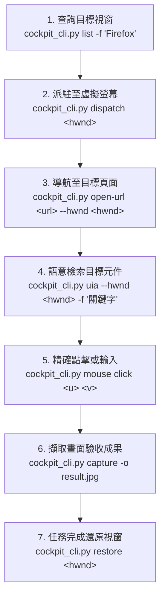

# Desktop Cockpit 2.0 (ADC 2.0) AI Agent 操作指引

本 Skill 專供 AI Agent 在 Windows 環境下操控桌面應用程式，實現**人機零干擾 (Zero-Interference)** 自動化：
- **實體滑鼠 0 位移、0 搶奪焦點**：所有目標應用程式均運行於獨立的虛擬第二螢幕（$X \ge 3200$）。
- **底層引擎端點**：由後台 Rust 引擎 (`gui-stream-engine`) 監聽 `ws://127.0.0.1:48280`。
- **唯一操作途徑**：AI Agent **一律使用標準 CLI 腳本** 執行所有控制，無需自行撰寫 WebSocket 通訊腳本。

---

## 1. 核心操作工具 (`scripts/cockpit_cli.py`)

> **腳本位置**：遵循 Agent Skill 規範，主腳本位於：
> - **全域路徑**：`D:\Users\arco0\.gemini\config\plugins\antigravity-desktop-cockpit\skills\desktop-cockpit\scripts\cockpit_cli.py`
> - **本地路徑**：`d:\AntiGravity\Agent-Study\antigravity-desktop-cockpit\skills\desktop-cockpit\scripts\cockpit_cli.py`

### A. 虛擬螢幕硬體控制 (零 UAC 彈窗、Win32 IOCTL 直通)
- **掛載虛擬螢幕**：
  `python.exe -X utf8 "D:\Users\arco0\.gemini\config\plugins\antigravity-desktop-cockpit\skills\desktop-cockpit\scripts\cockpit_cli.py" display on`
- **拔除虛擬螢幕**：
  `python.exe -X utf8 "D:\Users\arco0\.gemini\config\plugins\antigravity-desktop-cockpit\skills\desktop-cockpit\scripts\cockpit_cli.py" display off`
- **查詢顯示器拓撲**：
  `python.exe -X utf8 "D:\Users\arco0\.gemini\config\plugins\antigravity-desktop-cockpit\skills\desktop-cockpit\scripts\cockpit_cli.py" display status`

### B. 視窗查詢與派駐管理
- **查詢目標視窗 HWND**（支援關鍵字過濾）：
  `python.exe -X utf8 "D:\Users\arco0\.gemini\config\plugins\antigravity-desktop-cockpit\skills\desktop-cockpit\scripts\cockpit_cli.py" list -f "Firefox"`
- **派駐視窗至虛擬第二螢幕**（具備自動掛載自癒機制，支援十進位或 `0xHEX`）：
  `python.exe -X utf8 "D:\Users\arco0\.gemini\config\plugins\antigravity-desktop-cockpit\skills\desktop-cockpit\scripts\cockpit_cli.py" dispatch 0x6011E`
- **任務完成將視窗還原回主螢幕**：
  `python.exe -X utf8 "D:\Users\arco0\.gemini\config\plugins\antigravity-desktop-cockpit\skills\desktop-cockpit\scripts\cockpit_cli.py" restore 0x6011E`
- **鎖定串流目標視窗**：
  `python.exe -X utf8 "D:\Users\arco0\.gemini\config\plugins\antigravity-desktop-cockpit\skills\desktop-cockpit\scripts\cockpit_cli.py" set 0x6011E`

### C. 語意感知與節點搜尋 (Windows 原生 UIA 樹)
- **精準搜尋節點（推薦，自動過濾並輸出點擊提示）**：
  `python.exe -X utf8 "D:\Users\arco0\.gemini\config\plugins\antigravity-desktop-cockpit\skills\desktop-cockpit\scripts\cockpit_cli.py" uia --hwnd 0x6011E -d 16 --find "搜尋關鍵字"`
  > 輸出結構化表格（層級、類型、絕對中心點、歸一化 `(u, v)`），並自動生成點擊命令提示。
- **輸出 UIA 概覽統計**：
  `python.exe -X utf8 "D:\Users\arco0\.gemini\config\plugins\antigravity-desktop-cockpit\skills\desktop-cockpit\scripts\cockpit_cli.py" uia --hwnd 0x6011E -d 8 -s`
- **完整 JSON 樹傾印**：
  `python.exe -X utf8 "D:\Users\arco0\.gemini\config\plugins\antigravity-desktop-cockpit\skills\desktop-cockpit\scripts\cockpit_cli.py" uia --hwnd 0x6011E -d 4`

### D. 畫面擷取與瀏覽器安全導航
- **安全網址導航（杜絕熱鍵被 IDE 截走）**：
  `python.exe -X utf8 "D:\Users\arco0\.gemini\config\plugins\antigravity-desktop-cockpit\skills\desktop-cockpit\scripts\cockpit_cli.py" open-url "https://mail.google.com" --hwnd 0x6011E`
  > 自動聚焦目標瀏覽器網址列 (Ctrl+L) -> 注入網址 -> 送出 Enter。
- **擷取當前畫面為圖片**：
  `python.exe -X utf8 "D:\Users\arco0\.gemini\config\plugins\antigravity-desktop-cockpit\skills\desktop-cockpit\scripts\cockpit_cli.py" capture -o screen.jpg --hwnd 0x6011E`

### E. 滑鼠與鍵盤精準控制
- **滑鼠點擊 (支援歸一化與絕對像素座標自動轉換)**：
  - 歸一化座標：`python.exe -X utf8 "D:\Users\arco0\.gemini\config\plugins\antigravity-desktop-cockpit\skills\desktop-cockpit\scripts\cockpit_cli.py" mouse click 0.5583 0.2787`
  - 絕對像素座標：`python.exe -X utf8 "D:\Users\arco0\.gemini\config\plugins\antigravity-desktop-cockpit\skills\desktop-cockpit\scripts\cockpit_cli.py" mouse click 4272 301`
- **多語系文字輸入**：
  `python.exe -X utf8 "D:\Users\arco0\.gemini\config\plugins\antigravity-desktop-cockpit\skills\desktop-cockpit\scripts\cockpit_cli.py" type "輸入內容" --hwnd 0x6011E`
- **發送組合鍵**：
  `python.exe -X utf8 "D:\Users\arco0\.gemini\config\plugins\antigravity-desktop-cockpit\skills\desktop-cockpit\scripts\cockpit_cli.py" hotkey "ctrl+l"`

### F. 狀態差異比對 (Visual Memory)
- **檢測新彈窗或報錯對話框**：
  `python.exe -X utf8 "D:\Users\arco0\.gemini\config\plugins\antigravity-desktop-cockpit\skills\desktop-cockpit\scripts\cockpit_cli.py" diff`

---

## 2. 標準端到端自動化操作流程 (Recipe)

---

## 3. Agent 操作防雷守則

1. **嚴禁盲發 Ctrl+T 導航**：在未鎖定焦點時盲發快捷鍵會被當前 IDE 攔截，網頁導航一律使用 `open-url`。
2. **優先使用 UIA 結構樹而非視覺推測**：所有點擊優先使用 `uia --find` 抓取真實幾何 CenterPoint。
3. **人類優先仲裁**：使用者若在 UI 面板操作，引擎會暫停 AI 操作 1.5 秒，無需重複強發指令。
4. **瀏覽器 UIA 特性**：
   - **Firefox**：天生原生支援 UIA，即開即用。
   - **Chrome**：需在啟動時加上 `--force-renderer-accessibility` 參數以穿透網頁結構。
